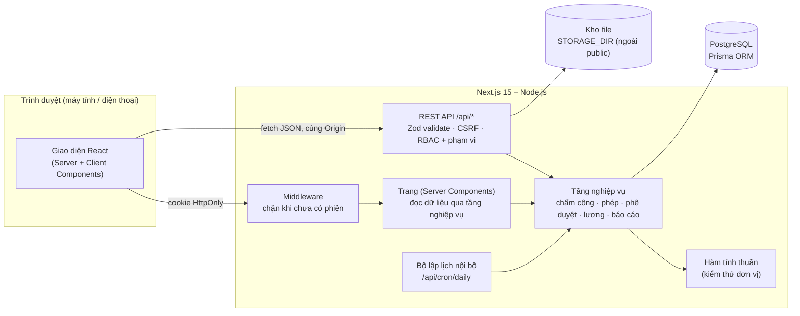
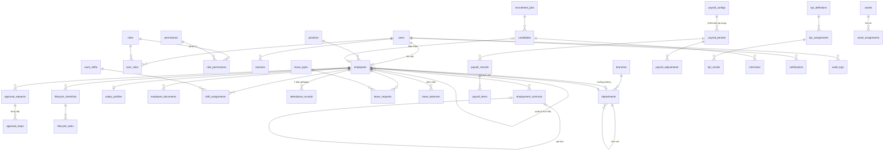

# Phần B – Kiến trúc hệ thống

## Sơ đồ kiến trúc



- **Một ứng dụng Next.js** đảm nhận cả giao diện và REST API (không cần backend riêng ở quy mô SME; tách được về sau vì nghiệp vụ nằm trong `src/lib/services`).
- **Kiểm tra quyền luôn ở phía máy chủ**: mọi trang gọi `requirePageAuth/requirePagePerm`, mọi API bọc bởi `api()` (xác thực phiên, MFA, đổi mật khẩu bắt buộc, chống CSRF, chuẩn hoá lỗi) và kiểm tra quyền + phạm vi dữ liệu cụ thể.
- **Logic tính toán thuần** (`attendance-calc`, `leave-calc`, `payroll-calc`, `kpi-calc`, `rbac`) không phụ thuộc DB → kiểm thử đơn vị.

## Công nghệ

| Lớp | Lựa chọn | Ghi chú |
|---|---|---|
| Frontend | Next.js 15 App Router, React 19, TypeScript, Tailwind CSS 4, Recharts 3, lucide-react | Component UI viết theo phong cách **shadcn/ui** nhưng không dùng CLI/Radix để giảm phụ thuộc; giữ cùng API (Button, Card, Dialog, Table…) |
| Backend | Next.js Route Handlers (Node runtime), Zod | REST + OpenAPI 3.1 tại `/api/openapi` |
| Database | PostgreSQL 17/18, Prisma 6 | Dev dùng gói `embedded-postgres` (PostgreSQL thật, không cần cài) vì máy phát triển không có Docker/PostgreSQL; Production dùng image `postgres` |
| Xác thực | Phiên lưu DB (token ngẫu nhiên 256-bit, cookie HttpOnly/SameSite=Lax, DB chỉ lưu SHA-256), bcrypt 12 vòng, TOTP RFC 6238 tự triển khai | Khoá tạm sau N lần sai, rate-limit theo IP |
| File | Lưu trên đĩa/volume ngoài `public`, phục vụ qua `/api/files/{id}` có kiểm tra quyền; kiểm tra chữ ký file (magic bytes), giới hạn 10MB | Có thể thay bằng S3/MinIO |
| Excel | exceljs | Nhập/xuất |
| PDF | In từ trình duyệt (trang in tối ưu, “Lưu dưới dạng PDF”) | Giữ đúng font tiếng Việt, không cần thư viện PDF phía máy chủ |
| Kiểm thử | Vitest (đơn vị), script HTTP end-to-end | `npm test`, `npm run test:smoke` |
| Triển khai | Docker (Next standalone, user không phải root), docker-compose | docs/06 |

## Cấu trúc thư mục

```
prisma/
  schema.prisma            # 45 bảng, enum, khoá ngoại, index
  migrations/              # migration SQL
  seed-lib.ts / seed.ts    # dữ liệu nền: quyền, vai trò, loại nghỉ, ca, cấu hình mẫu (nháp)
  seed-demo.ts             # dữ liệu DEMO cho kiểm thử (từ chối chạy khi NODE_ENV=production)
scripts/
  setup-env.mjs            # sinh .env với bí mật ngẫu nhiên
  dev-db.mjs               # PostgreSQL cục bộ cho dev
  create-admin.ts          # tạo Super Admin đầu tiên an toàn
  sync-permissions.ts      # bổ sung quyền mặc định sau nâng cấp
  backup.sh / restore-test.sh / backup.mjs
  smoke-*.mjs              # kiểm thử end-to-end
src/
  middleware.ts            # chặn route khi chưa có cookie phiên
  instrumentation.ts       # bộ lập lịch tác vụ tự động
  app/
    login/                 # đăng nhập + MFA
    (account)/account/     # đổi mật khẩu, bảo mật (ngoài layout chính)
    (app)/                 # mọi trang nghiệp vụ (layout: sidebar + topbar)
      page.tsx             # Dashboard
      employees/ departments/ org-chart/ attendance/ shifts/ leave/ approvals/
      payroll/ kpi/ recruitment/ lifecycle/ assets/ reports/ insights/
      notifications/ me/ settings/ checkin/ forbidden/
    api/                   # REST API (72 file route)
  components/              # ui/ (bộ component), shell/, charts, filter-bar, form-dialog…
  lib/
    db.ts auth.ts api.ts rbac.ts permissions.ts settings.ts audit.ts crypto.ts totp.ts qr.ts
    dates.ts format.ts labels.ts excel.ts storage.ts notify.ts sequence.ts openapi.ts
    attendance-calc.ts leave-calc.ts payroll-calc.ts kpi-calc.ts    # logic thuần
    services/              # attendance, leave, approval, employee, payroll, dashboard, reports, insights, automation
    validators/
tests/                     # kiểm thử đơn vị
docs/                      # tài liệu A–G
```

## Mô hình dữ liệu

Tên bảng theo yêu cầu (snake_case): `users, roles, permissions, role_permissions, user_roles, sessions, branches, departments, positions, employees, employment_contracts, employee_documents, salary_profiles, employee_allowances, salary_adjustments, work_shifts, shift_assignments, attendance_records, attendance_adjustments, overtime_requests, holidays, leave_types, leave_balances, leave_requests, approval_requests, approval_steps, payroll_configs, payroll_periods, payroll_records, payroll_items, payroll_adjustments, kpi_definitions, kpi_assignments, kpi_results, recruitment_jobs, candidates, interviews, lifecycle_checklists, lifecycle_tasks (onboarding/offboarding), assets, asset_assignments, notifications, audit_logs, company_settings, sequences`.



**Nguyên tắc dữ liệu**
- Tiền lưu số nguyên VND; ngày công kiểu `DATE`; thời điểm `timestamptz` (UTC) và hiển thị theo giờ Việt Nam.
- CCCD, số tài khoản ngân hàng, khoá TOTP **mã hoá AES-256-GCM** ở tầng ứng dụng; CCCD có thêm *blind index* (HMAC) để chống trùng hồ sơ mà không lưu bản rõ.
- Không xoá cứng dữ liệu nhân sự: hồ sơ “ngừng kích hoạt”, tài liệu xoá mềm, khoá ngoại `Restrict` với hợp đồng/lương/tài sản.
- Giao dịch nguyên tử cho phê duyệt (khoá lạc quan theo trạng thái + cấp), trừ/hoàn phép, tính lương, bàn giao tài sản, nhập Excel.
- Chống trùng: `employees.code/email/nationalIdHash` unique, `attendance_records(employee, workDate)` unique, `leave_balances(employee, type, year)` unique, `approval_requests(type, entityId)` unique, `notifications(user, dedupeKey)` unique.
- Index cho các truy vấn lọc chính (phòng ban, chi nhánh, trạng thái, ngày công, nhật ký theo đối tượng/thời gian).

## Ma trận phân quyền mặc định

Quyền = **Module × Hành động × Phạm vi dữ liệu** (Bản thân < Nhóm < Phòng ban < Chi nhánh < Toàn công ty). “Phòng” = phòng ban của người dùng + phòng ban họ làm trưởng (kèm phòng con). Nhiều vai trò → lấy phạm vi rộng nhất. Ma trận chỉnh được tại *Cài đặt → Phân quyền* (trừ Super Admin luôn toàn quyền). Sinh lại bảng: `npx tsx scripts/print-permission-matrix.ts`.

| Module | Hành động | Super Admin | Ban giám đốc | HR Admin | Trưởng phòng | Kế toán tiền lương | Nhân viên |
|---|---|---|---|---|---|---|---|
| Dashboard | Xem | Công ty | Công ty | Công ty | Phòng | Công ty | — |
| Hồ sơ nhân viên | Xem | Công ty | Công ty | Công ty | Phòng | Công ty | Bản thân |
| Hồ sơ nhân viên | Thêm | Công ty | — | Công ty | — | — | — |
| Hồ sơ nhân viên | Sửa | Công ty | — | Công ty | — | — | — |
| Hồ sơ nhân viên | Xóa/Ngừng | Công ty | — | Công ty | — | — | — |
| Hồ sơ nhân viên | Xuất | Công ty | Công ty | Công ty | — | — | — |
| Thông tin cá nhân nhạy cảm | Xem | Công ty | Công ty | Công ty | Bản thân | Bản thân | Bản thân |
| Thông tin cá nhân nhạy cảm | Sửa | Công ty | Bản thân | Công ty | Bản thân | Bản thân | Bản thân |
| Thông tin lương & tài khoản | Xem | Công ty | Công ty | Công ty | Bản thân | Công ty | Bản thân |
| Thông tin lương & tài khoản | Sửa | Công ty | — | Công ty | — | — | — |
| Hợp đồng lao động | Xem | Công ty | Công ty | Công ty | Bản thân | Bản thân | Bản thân |
| Hợp đồng lao động | Thêm | Công ty | — | Công ty | — | — | — |
| Hợp đồng lao động | Sửa | Công ty | — | Công ty | — | — | — |
| Tài liệu nhân viên | Xem | Công ty | Công ty | Công ty | Bản thân | Bản thân | Bản thân |
| Tài liệu nhân viên | Thêm | Công ty | — | Công ty | — | — | — |
| Tài liệu nhân viên | Xóa/Ngừng | Công ty | — | Công ty | — | — | — |
| Phòng ban, chi nhánh, chức vụ | Xem | Công ty | Công ty | Công ty | Công ty | Công ty | Công ty |
| Phòng ban, chi nhánh, chức vụ | Thêm | Công ty | — | Công ty | — | — | — |
| Phòng ban, chi nhánh, chức vụ | Sửa | Công ty | — | Công ty | — | — | — |
| Phòng ban, chi nhánh, chức vụ | Xóa/Ngừng | Công ty | — | Công ty | — | — | — |
| Chấm công & ca làm | Xem | Công ty | Công ty | Công ty | Phòng | Công ty | Bản thân |
| Chấm công & ca làm | Thêm | Công ty | Bản thân | Bản thân | Bản thân | Bản thân | Bản thân |
| Chấm công & ca làm | Sửa | Công ty | — | Công ty | — | — | — |
| Chấm công & ca làm | Duyệt | Công ty | Công ty | Công ty | Phòng | — | — |
| Chấm công & ca làm | Xuất | Công ty | Công ty | Công ty | Phòng | Công ty | — |
| Nghỉ phép | Xem | Công ty | Công ty | Công ty | Phòng | Công ty | Bản thân |
| Nghỉ phép | Thêm | Công ty | Bản thân | Bản thân | Bản thân | Bản thân | Bản thân |
| Nghỉ phép | Sửa | Công ty | — | Công ty | — | — | — |
| Nghỉ phép | Duyệt | Công ty | Công ty | Công ty | Phòng | — | — |
| Nghỉ phép | Xuất | Công ty | Công ty | Công ty | — | — | — |
| Tiền lương | Xem | Công ty | Công ty | Công ty | — | Công ty | — |
| Tiền lương | Thêm | Công ty | — | Công ty | — | Công ty | — |
| Tiền lương | Sửa | Công ty | — | — | — | Công ty | — |
| Tiền lương | Duyệt | Công ty | Công ty | — | — | — | — |
| Tiền lương | Xuất | Công ty | Công ty | Công ty | — | Công ty | — |
| Phiếu lương | Xem | Công ty | Công ty | Công ty | Bản thân | Công ty | Bản thân |
| KPI & đánh giá | Xem | Công ty | Công ty | Công ty | Phòng | Bản thân | Bản thân |
| KPI & đánh giá | Thêm | Công ty | Công ty | Công ty | Phòng | — | — |
| KPI & đánh giá | Sửa | Công ty | Bản thân | Bản thân | Bản thân | Bản thân | Bản thân |
| KPI & đánh giá | Duyệt | Công ty | Công ty | Công ty | Phòng | — | — |
| KPI & đánh giá | Xuất | Công ty | Công ty | Công ty | — | — | — |
| Tuyển dụng | Xem | Công ty | Công ty | Công ty | Phòng | — | — |
| Tuyển dụng | Thêm | Công ty | — | Công ty | — | — | — |
| Tuyển dụng | Sửa | Công ty | — | Công ty | — | — | — |
| Tuyển dụng | Xóa/Ngừng | Công ty | — | Công ty | — | — | — |
| Tuyển dụng | Xuất | Công ty | — | Công ty | — | — | — |
| Tiếp nhận / nghỉ việc | Xem | Công ty | Công ty | Công ty | Phòng | Bản thân | Bản thân |
| Tiếp nhận / nghỉ việc | Thêm | Công ty | — | Công ty | — | — | — |
| Tiếp nhận / nghỉ việc | Sửa | Công ty | — | Công ty | — | — | — |
| Tài sản | Xem | Công ty | Công ty | Công ty | Bản thân | Bản thân | Bản thân |
| Tài sản | Thêm | Công ty | — | Công ty | — | — | — |
| Tài sản | Sửa | Công ty | — | Công ty | — | — | — |
| Tài sản | Xuất | Công ty | — | Công ty | — | — | — |
| Báo cáo | Xem | Công ty | Công ty | Công ty | Phòng | Công ty | — |
| Báo cáo | Xuất | Công ty | Công ty | Công ty | — | Công ty | — |
| HR Insights | Xem | Công ty | Công ty | Công ty | Phòng | — | — |
| Quản trị tài khoản | Xem | Công ty | — | Công ty | — | — | — |
| Quản trị tài khoản | Thêm | Công ty | — | Công ty | — | — | — |
| Quản trị tài khoản | Sửa | Công ty | — | Công ty | — | — | — |
| Quản trị phân quyền | Xem | Công ty | — | — | — | — | — |
| Quản trị phân quyền | Sửa | Công ty | — | — | — | — | — |
| Cấu hình doanh nghiệp | Xem | Công ty | — | Công ty | — | — | — |
| Cấu hình doanh nghiệp | Sửa | Công ty | — | Công ty | — | — | — |
| Nhật ký hệ thống | Xem | Công ty | Công ty | Công ty | — | — | — |
| Nhật ký hệ thống | Xuất | Công ty | — | — | — | — | — |
| Sao lưu & khôi phục | Xem | Công ty | — | — | — | — | — |

Quy tắc bổ sung ngoài ma trận (cứng trong code):
- Không ai tự duyệt yêu cầu của chính mình; một người không duyệt 2 cấp của cùng yêu cầu; cấp 2 cần phạm vi toàn công ty.
- Người tính lương không được tự duyệt kỳ lương đó; kỳ lương đã khoá là bất biến (chặn tính lại, sửa công, duyệt phép/điều chỉnh công/tăng ca, sửa ngày lễ trong kỳ).
- Chỉ Super Admin gán được vai trò Super Admin hoặc vai trò có quyền sửa phân quyền, và thao tác trên tài khoản Super Admin; không ai tự đổi vai trò/khoá chính mình; luôn còn ít nhất 1 Super Admin hoạt động.
- Không tự sửa lương/phụ cấp, không tự sửa công trực tiếp (phải gửi đề nghị điều chỉnh).
